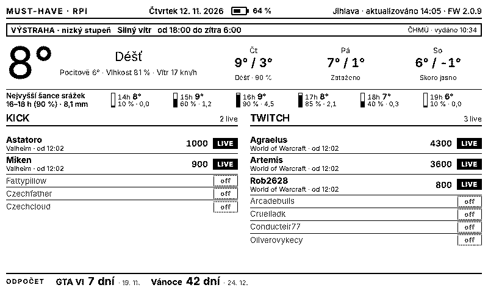

# TRMNL Must-have

One screen for a [TRMNL](https://trmnl.com) e-ink display (800×480): local weather plus the live status of the
Kick and Twitch streamers you follow (online/offline, viewers, category, start time).

The collector is plain Python 3.12 (standard library only). It runs on a timer, fetches the data and pushes it to a
TRMNL private plugin. TRMNL renders the screen from the Liquid templates in `templates/`.

Česká verze: [README.cs.md](README.cs.md)



## Data sources (no API keys required)

| Source | How |
| --- | --- |
| Weather | [Open-Meteo](https://open-meteo.com), coordinates from `config.toml` |
| Kick | unofficial `kick.com/api/v2/channels/<slug>` endpoint |
| Twitch | the public GraphQL endpoint the twitch.tv website uses (Client-ID read from the page, refreshed automatically), fallback [decapi.me](https://decapi.me) |

No Twitch or Kick developer application is needed.

## Configuration

`config.toml` holds the city, coordinates, the streamer lists and the send cadence. Streamers are plain string arrays;
edit the file and redeploy. Host-specific values (`[server] port`, `label`, `headless`) go into a git-ignored
`config.local.toml` next to it, which overrides the same tables and is never overwritten by `deploy/install.sh`.

```toml
[streams]
kick = ["fattypillow", "czechfather", "astatoro", "miken", "czechcloud"]
twitch = ["arcadebulls", "agraelus", "artemis", "cruelladk", "conducteir77", "oliverovykecy", "rob2628"]

[trmnl]
plugin_setting_id = 479481   # numeric id of your private plugin instance

[[countdown]]                # optional: days-to-go strip at the bottom of the screen
name = "GTA VI"
date = 2026-11-19
```

Each `[[countdown]]` entry becomes a "days to go" item (calendar days in the configured timezone, sorted by the
nearest date). The release day shows `DNES`; past events disappear on their own, unless the entry has
`yearly = true` (birthdays, Christmas), which rolls it over to the same day next year (29 Feb → 28 Feb). `[[countdown]]` entries in
`config.local.toml` are appended to the base list.

Secrets never live in the repo. The collector reads them, in this order of precedence, from the environment,
from a git-ignored `.env` file in the project root, or (macOS) from the Keychain:

| Variable | Purpose |
| --- | --- |
| `TRMNL_USER_API_KEY` | user API key (trmnl.com → Account). Used with `plugin_setting_id` to push data through the authenticated API and for `status`. |
| `TRMNL_WEBHOOK_UUID` | alternative: the UUID from the plugin's Webhook URL. If set, it is preferred and no API key is needed. |

Keychain entry: `security add-generic-password -s trmnl-musthave -a TRMNL_USER_API_KEY -w <key>`.

## Creating the private plugin

Everything can be done through the API with the user key (the TRMNL UI works too):

```bash
# 1. create the instance (plugin_id 37 = Private Plugin); note the returned id
curl -X POST https://trmnl.com/api/plugin_settings -H "Authorization: Bearer $TRMNL_USER_API_KEY" \
  -H "Content-Type: application/json" -d '{"plugin_id":37,"name":"Must-have"}'
# 2. upload strategy + templates as a zip archive (settings.yml with `strategy: webhook` + the .liquid files)
deploy/push_plugin.sh <id>
# 3. put the id into config.toml → [trmnl] plugin_setting_id
# 4. add the plugin to your device playlist (TRMNL UI → Playlists) and run once
python3 -m musthave run
```

## Commands

```
python3 -m musthave run            # fetch + push (respects the rate limits)
python3 -m musthave run --dry-run  # print the payload, send nothing
python3 -m musthave fetch          # JSON only
python3 -m musthave status         # devices on the account (needs TRMNL_USER_API_KEY)
uv run --with pytest pytest -q     # tests (no network)
uv run --with python-liquid preview/render.py --layout full   # local preview → preview/out.html
```

## Rate limits

TRMNL allows 12 pushes per hour (30 with TRMNL+) and a 5 kB payload. The collector runs every 5 minutes and
sends when the data changed (at most 12 pushes/hour) or as a heartbeat after 15 minutes. TRMNL re-renders a
private plugin no faster than every 15 minutes (`refresh_interval: 15` in settings.yml, in minutes, is the minimum
without TRMNL+; 5 and 10 get rounded up), so the device refresh is set to 15 minutes too. The payload is about 1.1 kB for 12 streamers; category names are shortened first and the
run fails loudly above 4.5 kB.

## BYOS mode: 5-minute updates without the TRMNL cloud

TRMNL re-renders a private plugin at most every 15 minutes unless you pay for TRMNL+. To update the screen every
5 minutes, run the built-in BYOS server instead and point the device at it. The server renders the same Liquid
template locally (headless Chrome → 1-bit PNG; the TRMNL framework CSS/JS is cached in `state/cache/` and the Inter
font ships in `musthave/assets/`, so a render never waits for the network; `deploy/install.sh` seeds the cache from the
local machine) and serves the three endpoints the firmware expects
(`/api/setup`, `/api/display`, `/api/log`). If a fetch or render fails, the previous image stays and the device
does not redraw (the `filename` does not change). The server still pushes data to the TRMNL cloud, so switching
back is a soft reset away.

The full layout shows a battery icon with a proportional fill and charge percentage next to the date.
The percentage is estimated from the device's last reported `Battery-Voltage` using the
[TRMNL OG calculation](https://help.trmnl.com/en/articles/10556850-device-battery-faq) and updates on the next
render. Without a valid reading, it shows `— %`.

```bash
uv venv .venv && uv pip install -p .venv/bin/python -r requirements-server.txt   # python-liquid + Pillow
.venv/bin/python -m musthave serve --once     # test render → state/screen/current.png
deploy/install_server_launchd.sh              # macOS: launchd agent with KeepAlive (replaces the collector agent)
```

Point the device at the server: hold the button on the back for 5 s, join the `TRMNL` Wi-Fi, in the captive
portal open **Advanced → Custom Server → Yes**, enter `http://<LAN-IP>:8080` (no trailing slash), then your Wi-Fi
credentials and Connect. Give the host a fixed LAN IP (DHCP reservation). Back to trmnl.com: pairing mode →
Advanced → Soft Reset, and clear the server field. `[server]` in `config.toml` sets port, refresh, image format
(`png` or `bmp`) and an explicit Chrome path. On a Raspberry Pi use `deploy/trmnl-musthave-server.service`
(`apt install chromium`).

## Protocol v1 (custom firmware)

With the [trmnl-musthave-firmware](https://github.com/JirakJ/trmnl-musthave-firmware) fork the device sends
`X-Frame-Id` (the frame it currently shows) and the server answers with `action: none | partial | full`. For
`partial` it serves `/frames/<id>.regions?from=<old>`: a small binary blob (`MHR1`) with up to 4 changed rectangles,
each carrying the old and new 1-bit pixels, so the panel refreshes only those windows without flashing. The server
also decides `sleep_mode` (light on USB, deep on battery, from the reported voltage), `refresh_rate`, when to do a
full refresh against ghosting (`full_after_partials`, `full_every_minutes`, `night_full_at`) and offers OTA from
`deploy/firmware/latest.bin` when `firmware_version.txt` differs from the device's version. Stock firmware keeps
working against the same server (it always takes the `full` path). See `docs/superpowers/specs/2026-09-16-custom-firmware-partial-refresh-design.md`.

## Hourly forecast (next 6 hours)

Under the current weather the full layout shows six hourly windows starting with the current hour: temperature,
probability of precipitation (bar + %) and the expected amount, plus a short summary such as
`Nejvyšší šance srážek 16–18 h (90 %) · 17,0 mm` or `Bez srážek do 15 h`. Data come from the same Open-Meteo
request (`hourly=temperature_2m,precipitation_probability,precipitation`, `timeformat=unixtime`):

- Open-Meteo reports precipitation for the *preceding* hour, so the window `h:00–h+1:00` takes its temperature
  from `h:00` and its precipitation from `h+1:00`. The summary names whole-hour windows only (no minute precision).
- Timestamps are unix time converted to the configured timezone, so windows cross midnight and DST correctly
  (two `02h` in October, none in March).
- Missing values are shown as `—`, never as zero, and the summary admits `část dat chybí`.
- When the weather runs on its last good data (up to 3 h), windows that already ended are dropped and the screen
  shows `data z HH:MM`.
- The TRMNL cloud payload (5 kB limit) is fitted by `fit_for_cloud()`: hourly data are dropped before anything
  essential when the payload would not fit; the local BYOS render has no such limit.

Previews: `preview/scenarios/hourly-{dry,heavy,missing,midnight}.json`, rendered with `preview/shot.py`.

## Panels and profiles (full layout)

Without a `[layout]` table the full layout stays as before (weather with the hourly strip, Kick and Twitch columns,
countdown). With it you choose the panels, their order and width, and time-based profiles:

```toml
[layout]
panels = ["kick", "twitch"]   # 1–3 columns: kick, twitch, streams (combined list), agenda, reminders
widths = { twitch = 2 }       # flex weight 1–3 (default 1)
weather = "full"              # full (with hourly forecast) | compact (no hourly, smaller) | off
countdown = true
hide_empty = ["kick"]         # hide when empty (nobody live / no items) – the space goes to the other panels
shrink_empty = []             # or shrink to a narrow header-only column
min_switch_minutes = 30       # a profile change is taken over at most this often (no carousel)

[[layout.profile]]
name = "pracovní den"
days = ["po", "út", "st", "čt", "pá"]   # po út st čt pá so ne (or mon … sun)
from = "07:00"
to = "17:00"                            # may cross midnight; the day is the day the window starts
panels = ["agenda", "reminders"]
weather = "compact"
```

Rules: the first matching profile in file order wins (overlaps are allowed), otherwise the base `[layout]` applies.
Times are local in `[location] timezone`. A window `22:00–02:00` with `days = ["pá"]` also covers Saturday 01:30.
A profile switch is taken over no sooner than `min_switch_minutes` after the previous one, and because identical data
produce an identical frame (`action: none`), the device redraws only when the content really changes. An unavailable
source is never treated as "empty" and hidden; if every panel would be hidden, the first one stays. Unknown panels,
duplicates, more than three columns, `streams` combined with `kick`/`twitch`, bad times or days fail with a clear
configuration error (the server keeps the previous frame). Panels have fixed content limits: rows that do not fit
completely are pushed into a hidden overflow column, so a cut-off row never appears on the e-ink.

The half/quadrant templates keep their fixed content (weather + Kick/Twitch); `[layout]` applies to the full layout.
Previews: `preview/make_scenarios.py` generates `preview/scenarios/*.json` (normal day, all streams offline, long
texts, compact/shrink variants, …) and `preview/shot.py` renders them through the device pipeline.

## Agenda from ICS calendars

An `agenda` panel (add it to `[layout] panels`) lists the next events of today and tomorrow from one or more ICS feeds
(read-only): time, title and optionally the place; ongoing events show `TEĎ`, all-day events `celý den`, an empty
day `Dnes bez událostí`, more events `+N dalších`.

Calendar addresses usually contain a secret token, so they are **never** read from the public `config.toml` (it
fails with an error if you try): put them into the git-ignored `config.local.toml` or the environment / `.env`:

```toml
# config.local.toml
[agenda]
sources = ["https://calendar.google.com/calendar/ical/…/private-…/basic.ics", "/home/pi/exported.ics"]
```

```
MUSTHAVE_ICS_URLS="webcal://… https://…"   # whitespace-separated, merged with config.local.toml
```

Other `[agenda]` keys may stay in `config.toml`: `days` (2 = today + tomorrow), `max_items` (5), `private` (true =
titles shown as `Obsazeno`, no places), `show_location`, `refresh_minutes` (15), `max_age_hours` (12). `webcal://`
becomes `https://`, credentials in the URL (`https://user:pass@…`) are sent as HTTP Basic. Addresses never reach the
payload, the state file or the logs (sources are identified by number and a hash; errors are logged as
`agenda source #1 failed: HTTP 404`).

Supported iCalendar subset (RFC 5545, stdlib parser in `musthave/ics.py`): `VEVENT` with `DTSTART`/`DTEND`/`DURATION`
in UTC, with `TZID` (IANA names plus common Windows names from Outlook/Exchange; unknown zones fall back to the
dashboard zone) or floating; all-day `VALUE=DATE` (also multi-day); `RRULE` with `FREQ=DAILY|WEEKLY|MONTHLY|YEARLY`,
`INTERVAL`, `COUNT`, `UNTIL`, `BYDAY` (incl. `1MO`/`-1FR` monthly), `BYMONTHDAY`, `BYMONTH`; `EXDATE`, `RDATE`,
`RECURRENCE-ID` (moved or cancelled instance), `STATUS:CANCELLED`. Recurrences keep the local start time across DST
changes. Events with other `RRULE` parts (`BYSETPOS`, `BYHOUR`, …) are skipped and counted in the log rather than
shown wrongly; `VTIMEZONE` definitions are not interpreted. Limits: 3 MB per feed, 15 s timeout, 20 000 events,
recurrence expansion only inside the window and at most 3 000 steps per event (long-running daily series are
fast-forwarded). Ordering is stable: day → all-day first → start → end → calendar order → title.

Outages: each feed is fetched at most every `refresh_minutes` (retry after 2 min on error); a failing feed uses its
cached events for up to `max_age_hours` and the panel shows `data z HH:MM`; older cache is not shown as the current
agenda (`Agenda nedostupná`, or `část kalendářů nedostupná` when only some feeds fail). Verified with a real Google
Calendar export.

## Daily priorities and recurring reminders

A `reminders` panel (title `DNES`, add it to `[layout] panels`) shows up to three priorities for today and the
nearest reminders. They are configured locally, need no account and are separate from the `[[countdown]]` strip:

```toml
[[priority]]
text = "Dopsat nabídku"            # every day; with date = 2026-11-12 only on that day (max 3 shown)

[[reminder]]
name = "Vynést koš"
weekly = ["út", "pá"]               # po út st čt pá so ne

[[reminder]]
name = "Zaplatit nájem"
monthly = 31                        # day of month
short_month = "last"                # 29–31 in a shorter month: "last" = last day (30 Apr, 28/29 Feb), "skip" = none
lead_days = 3                       # show 3 days ahead ("za 3 dny"); 0 = only on the day

[[reminder]]
name = "Zubař"
date = 2026-11-14                   # one-off

[reminders]
max_items = 5                       # +N more beyond that
```

An occurrence is visible from `date − lead_days` until the end of its day and disappears the next day (nothing is
carried over). Dates are local calendar dates in `[location] timezone`. Order: date, then configuration order;
completed occurrences move to the end. Completion is stored per occurrence (`state/done.json`, name + date), so next
week's occurrence is open again: `python3 -m musthave done "Vynést koš" [--date 2026-11-12] [--undo]` (the local web
admin offers the same). `[[reminder]]`/`[[priority]]` entries in `config.local.toml` are appended to the base list.

## Streams: favourites, LIVE-only, combined list

```toml
[streams]
kick = ["fattypillow", "czechfather"]
twitch = ["agraelus", "rob2628"]
mode = "all"                 # all (default, as before) | live | live_summary (live + one line "offline: …")
favorites = ["twitch:agraelus", "kick:fattypillow"]   # identity = platform:slug/login, never the display name
max_items = 0                # per list, 0 = unlimited; hidden ones show as "+N dalších"
combined = false             # one list across Kick and Twitch with a K/T badge
```

Stable order: live favourites (in `favorites` order) → other live channels by viewers, ties by platform and id →
offline favourites → other offline channels in configuration order. The limit is applied after sorting, so live
channels win. `live` shows `Nikdo nevysílá` when nobody is live; a source outage still shows `Kick nedostupný`
(never "nobody is live"). When one channel's request fails, its last known state (≤ 30 min since it was actually
fetched) is kept and marked instead of flipping it offline; without history it shows `name ?`. The combined list keeps
category, viewers and start time and names a platform that has no data (`bez Kick`).
Previews: `preview/scenarios/streams-*.json`.

## ČHMÚ weather warnings

An optional strip under the header shows the most severe valid or upcoming ČHMÚ warning for the configured area:
level (`nízký` / `vysoký` / `extrémní stupeň`; high levels are inverted black so they read without colour), event,
validity, `+N další` when more warnings apply, the source and the issue time. It is an informative addition to the
official warnings, not a replacement.

```toml
[alerts]
area_codes = ["6105"]   # ORP codes from the ČSÚ codebook 65 (CISORP); Jihlava = 6105; empty = disabled
feeds = ["50"]          # 50 = meteorological warnings (SIVS), 70 = hydrological drought
refresh_minutes = 15    # listing check interval; a new XML is downloaded only when the file changes
max_age_hours = 6       # cached warnings older than this → "Výstrahy ČHMÚ nedostupné"
horizon_hours = 24      # show warnings starting within this time
show_none = false       # true = show "Bez platné výstrahy" too
```

How the source is used (verified 11/2026 against <https://opendata.chmi.cz/meteorology/weather/alerts/cap/> and its
`metadata/Dokumentace_CAP.pdf`): each `alert_cap_50_DDHHMM.xml` is a complete SIVS snapshot for the whole country;
file names are recycled monthly, so the newest file is picked by its listing time, verified by `<sent>`, and an older
message never replaces a newer cache. Areas are matched by `CISORP` geocodes, only Czech `<info>` blocks with an
`awareness_level` and a certainty other than `Unlikely` count, `Cancel`/non-`Actual` messages carry no warnings, and
warnings past `<expires>` (or `eventEndingTime`) disappear even from the cache. Priority: highest level, then earliest
onset, then name. "No warning" (strip hidden or `Bez platné výstrahy`) is distinct from "source unavailable"
(`Výstrahy ČHMÚ nedostupné`), so a dead feed never looks like an all-clear. The parser limits download size and the
number of blocks and rejects DTD/ENTITY declarations (no entity expansion, no external references). Data: ČHMÚ open
data (attribution "ČHMÚ" is shown on the strip; check the dataset entry in the national open-data catalogue for the
current licence terms).

## Battery saving (night mode, low battery)

Saving changes the `refresh_rate` the server sends to the device, so the device actually wakes up less often
(skipping renders alone would not save anything). Settings live in `[server]`:

| Key | Default | Meaning |
| --- | --- | --- |
| `saving_mode` | `auto` | `auto`, `off` (never save) or a forced `quiet` / `low` |
| `quiet_start`, `quiet_end` | empty (off) | quiet window in local time, may cross midnight (`"23:00"`–`"06:00"`) |
| `interval_quiet` | 1800 | seconds between wake-ups in the quiet window |
| `quiet_on_usb` | false | apply the quiet window on USB power too |
| `low_battery_enter` / `low_battery_exit` | 0 (off) / enter + 5 | battery % thresholds with hysteresis |
| `interval_low_battery` | 900 | seconds between wake-ups on low battery |
| `max_refresh_seconds` | 3600 | upper bound of any `refresh_rate` sent to the device |

Order of rules: OTA waiting (20 s) → forced `saving_mode` → power (USB does not save) → low battery → quiet window;
when both apply the longer interval wins. The quiet window is computed in the configured timezone, so it works across
midnight and DST changes, and the last wake-up in the window is scheduled for its end (never a whole extra quiet
interval later). The low-battery state uses the last plausible voltage; an unknown or implausible reading keeps the
previous state instead of pretending 0 %. Long intervals are aligned to the `align_minutes` slots. `/status` shows
the active mode, its reason and the expected next contact; the full layout shows a short `noční režim` / `úspora`
tag next to the battery.

## Web admin in the home network (`/admin`)

`http://<host>:<port>/admin` edits the everyday settings without touching TOML by hand: location (name,
coordinates, timezone), Kick/Twitch channels, stream mode, favourites, limit and combined list, your own countdowns
and the base full-layout panels / weather variant / hidden empty panels. Profiles, reminders and calendar sources
stay in `config.local.toml` (the page only shows how many calendars are configured, never their addresses). Today's
reminders can be marked done there.

- **Access**: a locally managed token in `state/admin_token` (0600). Show it on the server with
  `python3 -m musthave admin-token`; it is never logged. After login a session cookie (`HttpOnly`,
  `SameSite=Strict`, in memory only, 12 h) is used; every write needs the session's CSRF token and a same-origin
  `Origin`/`Referer`; failed logins are rate-limited.
- **Storage**: only `config.local.toml` is written; values equal to the public `config.toml` are left out so later
  changes in Git are not masked; other sections (`[server]`, `[agenda]`, …) are kept. Countdowns from `config.toml`
  are read-only and only your own entries are written, so saving repeatedly never duplicates them. Secrets stay in
  `.env`/environment and never appear on the page.
- **Validation**: invalid coordinates, timezone, dates, channel names or layout produce specific messages and
  nothing is written; the whole new file is also checked by the same `load_settings` the server uses. Writes are
  atomic (temp file + rename) and the previous version is kept in `config.local.toml.bak` (`Obnovit předchozí
  nastavení`).
- **Preview vs. activation**: `Náhled` renders the draft through the same pipeline as the display (fresh data →
  `build_payload` → Chromium → 1-bit PNG) without saving anything and without putting the frame into the store, so
  the device never receives it. `Uložit a aktivovat` is the separate activation; the next render picks it up. The
  page shows whether the current configuration is saved, rendered (`render.json` records the configuration hash of
  the frame) and confirmed by the firmware (`X-Frame-Id` of that frame).

Changes of `[server]` keys (port, intervals, saving policy) still need a service restart.

## Status page (`/status`, `/status.json`)

The BYOS server shows a readable overview at `http://<host>:<port>/status` (JSON at `/status.json`):

- **frames**: the last *rendered* frame (render loop), the frame *offered* to each device (sent in a `partial`/`full`
  answer) and the frame *confirmed* by the firmware. A frame counts as confirmed only when the device's next request
  carries it in `X-Frame-Id`; a sent response is not a confirmation. Stock firmware sends no `X-Frame-Id`, so its
  frames always stay unconfirmed.
- **device**: last contact, the interval it was actually given (`refresh_rate`) and the expected next contact,
  firmware, battery estimate and Wi-Fi. A device is `opožděné` (late) after the expected wake-up and `neaktivní`
  (inactive) only after `[server] offline_tolerance_seconds` (default 600) more, so deep sleep is never an outage.
- **Wi-Fi**: the last valid `RSSI` header (−120…−1 dBm) and when it was measured; missing or invalid values keep the
  previous measurement, without any measurement the state is `neznámý`. Percent = `2 × (RSSI + 100)` clamped to
  0–100 (−100 dBm = 0 %, −50 dBm or better = 100 %).
- **data freshness**: the time of the last *successful* fetch of each source, independent of the render time.
  When a source runs on its last good data, the screen shows `data z HH:MM` (the fetch time) instead of the render time.

The status is server-side only; the frozen e-ink frame never claims the display is online or offline.

## Deploying to a Raspberry Pi

Collector host (cloud push via timer):

```
deploy/install.sh [ssh-host]      # rsync to ~/trmnl-musthave + systemd timer (5 min); copies .env if present
ssh rpi journalctl -u 'trmnl-musthave@*' -n 20
```

`install.sh` refuses to run on a host where the BYOS server service is enabled (it would turn on the collector
timer); override with `FORCE_COLLECTOR=1` only if you really want both.

BYOS server update (one command, backup and verification):

```
deploy/deploy_server.py deploy v1.7.0 --dry-run      # plan only: commit, files, target checks
deploy/deploy_server.py deploy v1.7.0                # deploy, verify, wait for the device to confirm
deploy/deploy_server.py rollback v1.7.0              # restore the code that ran before v1.7.0
```

`deploy` takes the exact commit of the tag, builds the archive with `git archive` (only tracked files, so no
secrets, state or virtualenv; the archive is checked for protected paths) and a SHA-256 manifest, uploads both to
`state/deployments/<tag>/` and backs up the running code (`before-<tag>.tar.gz`, kept on repeated runs). It then
rsyncs the new code into place while never touching `config.local.toml(.bak)`, `.env`, `.venv`, `state/` (device
registry, frames, caches, admin token), `deploy/firmware/*.bin` and `ota_wait`; dependencies are reinstalled only when
`requirements-server.txt` changed, and no collector timer is ever enabled. After restarting
`trmnl-musthave-server@<user>` it verifies that the deployed files match the manifest, the service is active, a
render finished after the restart without errors and the current frame is a valid 1-bit 800×480 PNG; any failure
restores the backup and restarts the service. It reports separately the server activation, the frame offered to the
device and the firmware confirmation via `X-Frame-Id`; the wait is bounded by the device's scheduled wake-up plus
10 minutes (max 2 h, `--ack-timeout`, `--no-wait`). No confirmation ends as `nasazeno, zařízení nepotvrdilo` without a
rollback, because a sleeping display is not a failed deployment. The summary is written to
`state/deployments/<tag>/result.json`.

## Layout

```
musthave/   config, http, weather, kick, twitch, payload, state, trmnl (push clients), run,
            alerts (ČHMÚ CAP), ics + agenda, reminders, streams, layout, status, admin + tomlw,
            screen (render) + frames + diff + policy + devices + server + serve (BYOS v1), __main__
templates/  full / half_horizontal / half_vertical / quadrant .liquid
preview/    render.py, shot.py (1-bit device render), make_scenarios.py → scenarios/*.json, sample.json
deploy/     systemd units + timer, install.sh, deploy_server.py, push_plugin.sh, launchd plists, BYOS server unit
tests/      pytest with fixtures captured from the real APIs
docs/superpowers/  design spec and implementation plan (Czech)
```

## License

MIT
